<!-- you read the source. respect. 👾 -->

  

 

### `❯ ls ~/projects --featured`

| project | what it does | stack |
|:--|:--|:--|
| [**ai-dream**](https://github.com/17med/AI-dream) | an ESP32 that feels a mood 7× a day, thinks one sentence, commits it to GitHub | `C++` `LVGL` `NVIDIA NIM` `Supabase` |
| [**tickets_system**](https://github.com/17med/Tickets_System) | ticket management platform | `TypeScript` |
| [**webrtc-one-to-one**](https://github.com/17med/webrtc-one-to-one) | peer-to-peer video calls over WebRTC | `JavaScript` `WebRTC` |
| [**nextauth_prototype**](https://github.com/17med/nextauth_prototype) | authentication prototype | `Next.js` `NextAuth` |
| [**menusystem**](https://github.com/17med/menusystem) | menu UI on an I2C OLED screen | `MicroPython` |
| [**project_iot**](https://github.com/17med/project_iot) | control a lamp from the web | `ESP32` `Flask` |

 

### `❯ git log --stat`

  
  

  

 

### `❯ exit`

  
  
  
  

